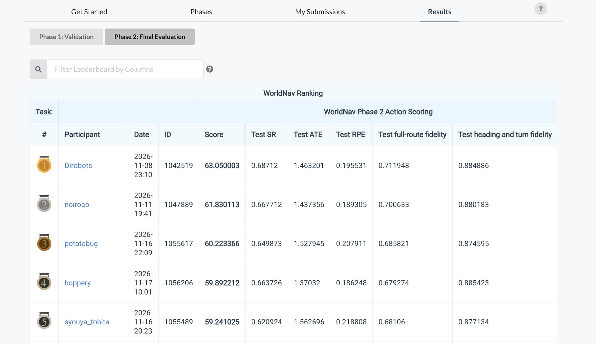

We participated in [RoboWorld 2026 Track 1](https://roboworld2026.github.io/track1.html) and were 3rd on the live leaderboard (16 Nov 2026).

Architecture:

Competition page: https://www.codabench.org/competitions/18185/#/results-tab

Phase 2: Final Evaluation. Our team is potatobug.

