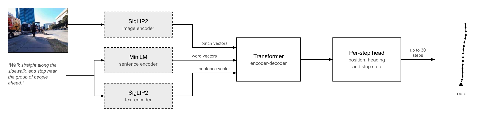
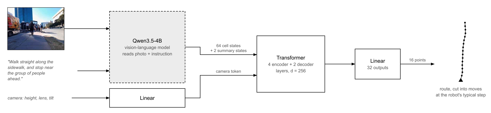
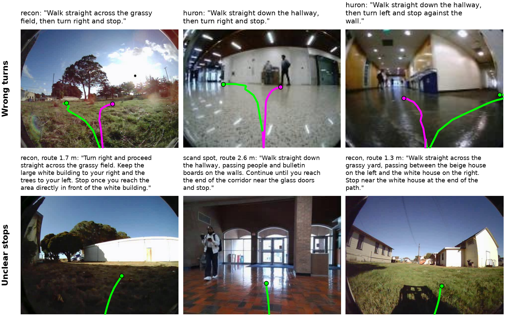
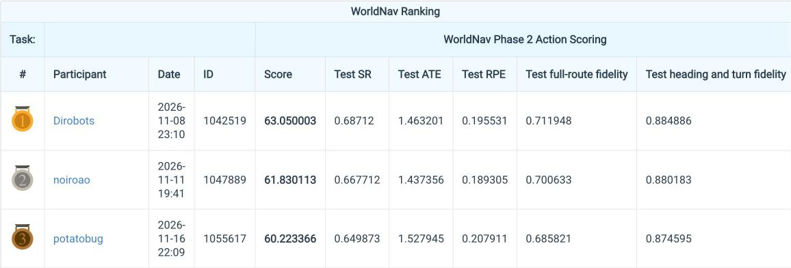
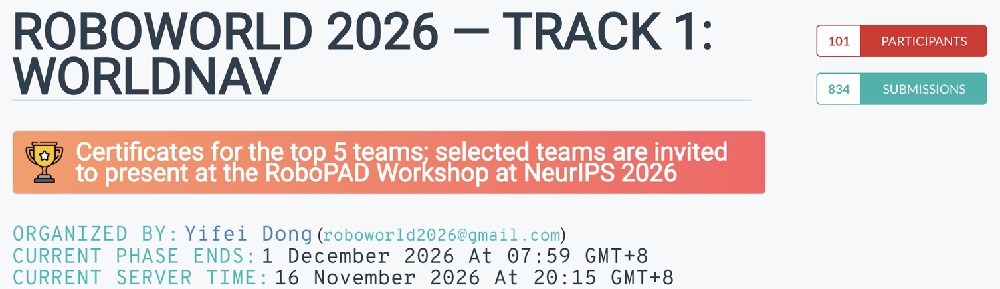

# RoboWorld 2026 Track 1: Predicting Robot Routes from a Single Photo and an Instruction
SC4001: Neural Networks and Deep Learning
Academic Year 2026/2027, Semester 1
Group 16
Name
Matriculation Number
Huang Yuxuan
U2322037E
Sim Jian An
U2322266B

## 1. Introduction

Autonomous robots are becoming a familiar sight in our daily lives, from robots delivering medicine in hospitals to those cleaning the floors in the university campus. Whatever their task, all these robots depend on their ability to navigate. Telling a robot where to go is usually done through coordinates or an image of the destination, but a user in real-world scenario may not have access to either (Dong et al., 2026). Therefore, a natural alternative is to describe it through words which can also convey landmarks and directions along the way. 

This brings us to language-conditioned visual navigation (LCVN) (Dong et al., 2026), where a model predicts a robot's entire route from a single photo and instruction, with no further observations along the way. This task is part of the WorldNav category of the RoboWorld Challenge 2026, an ongoing challenge affiliated with NeurIPS 2026 (Figure A.1). The challenge comes with a live leaderboard where teams all over the world are scored on the same test set, giving us a benchmark for how our approach fared as compared to others. Furthermore, participants are provided an annotated dataset of real robot trajectories allowing us to focus on designing the model, while the official metrics and baseline models from the LCVN paper give us a clear target to measure against.

In this report, we will share our process of iterating through our model designs and how we realised that a model which follows the instruction well may not perform well on the benchmark. Finally, we will explain how we adjusted our approach to perform better on the leaderboard. Our final submission scored 60.22, placing third out of 101 participants/groups on the leaderboard at the time of writing (Figure 4).

## 2. Related work

### 2.1 Visual navigation

During navigation, a robot perceives its surroundings through sensors such as cameras and LiDARs (Zhu et al., 2021). As visual navigation relies mainly on cameras, this gives the agent an egocentric (first-person) view of the environment.

Even though an agent is able to see its surroundings, it must also know where it needs to go. In goal-conditioned visual navigation, the destination is conveyed as an image. Models such as General Navigation Model (GNM) (Shah et al., 2023) and Navigation with Goal Masked Diffusion (NoMaD) (Sridhar et al., 2023) learn from trajectories recorded on real robots to predict the path between the current view and the goal image. Like these models, our model represents the path as a sequence of waypoints related to the robot's starting position.

### 2.2 From instructions to routes

Unlike having an image as the destination, an instruction can describe landmarks and directions along the way. Following such instructions is the basis of Vision-and-Language Navigation (VLN) (Anderson et al., 2018), where agents are evaluated in simulators that render a new view after every action.

Language-conditioned visual navigation (LCVN) (Dong et al., 2026) on the other hand, applies such instructions to real-word context under stricter conditions. Given a single egocentric image and an instruction, the agent must predict its entire route as a sequence of continuous movement, with no further observations along the way. This predicted path is then compared with trajectories recorded by real robots. Dong et al. (2026) proposes two baselines, a combination of a diffusion-based world model (LCVN-WM) paired with an actor-critic agent (LCVN-AC) and a unified autoregressive predictor (LCVN-Uni) fine tuned from GAIR Anole-7B (Chern et al., 2024). As such, we explore whether a lightweight model can remain competitive with these baselines. 

### 2.3 Pretrained models we build on

With our limited compute, training image and text encoders from scratch is not feasible, so we rely on transfer learning. The following pretrained models were used:
  - SigLIP 2 (Tschannen et al., 2025): A vision-language encoder trained to match images with their descriptions. 
  - DINOv3 (Siméoni et al., 2025): A self-supervised image encoder which obtains spatially aware feature maps from raw input image.
  - Depth Anything 3 (Lin et al., 2025): A monocular depth estimator which allows the model to comprehend distance from a single phto.
  - Qwen3.5-4B (Qwen Team, 2025) : A vision-language model used to process both images and text

These models are then fine-tuned with low-rank adapter (LoRA) (Hu et al., 2022) which train a small number of added weights while the original weights of the pretrained models stays frozen. 

## 3. Task, data and evaluation

### 3.1 Task

Given a single egocentric image and an instruction, the model must output the robot's entire route as a sequence of moves, with no further observations along the way. Every movement can be broken down into three values, dx, dy and dyaw. dx and dy are the forward and leftward displacement with respect to the robot's current frame while dyaw is the change in heading in radians. When the sequence of movement ends, the robot's entire route is then scored against the route recorded by the real robot.

### 3.2 Data

The organisers provide a labelled training set, a labelled validation set, and a test set whose labels are hidden.

The data comes from seven sources, each recorded by a different robot in its own kind of place, so each has its own camera, speed and typical route. In this report, we call each source a robot.

| Robot | Recorded by | Train | Val |
|---|---|--:|--:|
| Stanford real | Small wheeled robot, indoors | 17,817 | 2,130 |
| Stanford sim | The same, in a simulator | 7,017 | 843 |
| HuRON | Wheeled robot, indoors | 23,040 | 2,850 |
| RECON | Wheeled robot, outdoor fields | 25,368 | 3,240 |
| SCAND Spot | Legged robot, university campus | 11,553 | 1,506 |
| SCAND Jackal | Wheeled robot, university campus | 1,644 | 237 |
| TartanDrive | Off-road vehicle | – | 4,500 |
| **Total** | | **86,439** | **15,306** |

Table 1: Composition of the labelled data (episodes per robot)

The test set has 15,303 episodes, of which about 45% (6,813, by our classifier's estimate) are TartanDrive.

### 3.3 Metric
Each episode is scored as follows and the final score is the average over all episodes:

    Score = 100 x F x (1 + H) / 2 x (0.7 + 0.1 SR + 0.1 / (1 + ATE) + 0.1 / (1 + RPE))

| Metric | Better | Measurement | Range |
|---|---|---|---|
| Route fidelity (F) | Higher | How closely the predicted route follows the shape of the actual route, calculated as 1 - (Fréchet distance ÷ the true route’s span), multiplied by the smaller value of 1 and (true length ÷ predicted length) to penalise overshooting. | 0 to 1 |
| Heading and turn fidelity (H) | Higher | How closely the robot's predicted facing direction matches the actual during travel and how well the turns match in direction, angle and position along the route | 0 to 1 |
| Success rate (SR) | Higher | Whether the predicted end point lies within the larger value of 1.5m and the average step length of the actual end point. If it does, a score of 1 is given, otherwise, it will be 0 | 0 or 1 |
| Absolute trajectory error (ATE) | Lower | Root-mean-square distance between predicted and true positions, compared step by step | 0m and up |
| Relative pose error (RPE) | Lower | Root-mean-square error of each step's displacement | 0m and up |

Table 2: Metrics that make up the challenge's score

### 3.4 Evaluation

Scores on the organisers' hidden test set, which we call the Final Evaluation, are only available by submitting to CodaBench. So we made our own split from the labelled data:

- Training: Most of the organisers' training data.
- Validation: The remaining 10% of the training data, used to choose between designs.
- Test: The organisers' validation set, used to report results.

TartanDrive only appears in the organisers' validation set, so we split its recordings across our training, validation and test. This way every robot appears in all three, which lets us estimate our models' performance on the Final Evaluation properly, without having to submit to CodaBench.

The early models in Section 5 were trained without TartanDrive, as we followed the organisers' setup at that point in time. The above evaluation setup is used from Section 7 onwards.

In all the experiments, we change one component at a time and average each result over 3 seeds for reliability. For the final models submitted to CodaBench, they are retrained on all labelled data.

## 4. Baseline

### 4.1 Simple baseline
To establish a lower bound, we first evaluate a naive baseline that ignores both the image and the instruction. For every episode, a straight route is predicted where the length is the median route length of the corresponding robot. For this basic baseline, it scored 26.8 on the six robots seen in training and 33.7 on TartanDrive, which is absent from training. Together, an average score of 30.3 is obtained on the validation set.

### 4.2 Organisers' baseline
While the organisers did not report the baselines’ scores on the metric in Section 3.3, they did report success rate (SR), absolute trajectory error (ATE) and relative pose error (RPE) on the test split (Table 3). ATE and RPE are computed in the same way as in Section 3.3, but SR uses a stricter success radius, so the baselines’ SR is not directly comparable with ours.

| Model | SR | ATE | RPE |
|---|--:|--:|--:|
| LCVN-Uni | 0.36 | 0.65 | 0.22 |
| LCVN-WM + LCVN-AC | 0.34 | 0.76 | 0.26 |

Table 3: Organisers’ baseline results on the test split.

## 5. Initial exploration of model designs

### 5.1 Starting model

Our inital approach was to tackle the task as a human would. We would need to understand the instruction, understand the image, know how the instruction relates to the image, and finally draw a path.

Hence we started off with:
- Image: SigLIP2 patch features (frozen).
- Instruction: MiniLM word features + a SigLIP2 sentence feature (frozen).
- Relating the information and drawing the path: A small transformer over the image patches and instruction features.
- Output format: The position and heading after each step (up to 30 steps) plus which step to stop at, trained on the distance to the true positions (not the score).

Figure 1: Architecture of the starting model. Dashed grey boxes indicate frozen pretrained models.

This model scored 28.2, below the naive baseline (30.3). Upon breaking the score down, the reason was that despite beating the baseline on the six robots it was trained on (38.5 vs 26.8), it lost heavily on TartanDrive (18.0 vs 33.7), which was not in its training data at this point. This indicates that what is learned in the six robots does not translate well to TartanDrive, or to one another.

### 5.2 Attempted improvements

The evaluation is done on our test split unless marked "Final Evaluation". To save time, we tested on selected groups of the dataset instead of entire dataset.

| Component | Change | Effect | Measured on |
|---|---|---|---|
| Inputs | Qwen3.5-4B features instead of SigLIP2 (same transformer and other inputs) | +1.6 | RECON |
| Inputs | Depth (Depth Anything 3) added to the Qwen model | +0.3 on Final Evaluation, within noise | TartanDrive |
| Inputs | Grounding maps (where each sentence points in the photo) | +1.0, within noise | all robots |
| Output | 16 points along the route instead of the position after each move | +2.6 | all robots but TartanDrive |
| Output | Other output formats (actions, curves, typical routes, step size) | all tie or lose (Table A.1) | RECON, TartanDrive |
| Training | Training on a smooth version of the score instead of on position error | about +2 | RECON |
| Training | Mirrored copies (photo flipped, left/right swapped in the text) | -0.2, within noise | all robots |
| Training | Network width, depth, dropout, learning rate | under 1 point | RECON |
| Training | Averaging several trained models | +0.8 over the best single model | all robots |

Table 4: Attempted improvements

To improve the model further, we tried changes to the model's inputs, its output format and how it is trained.

#### Inputs

We first tried improving what the model takes in, with stronger features for the photo and instruction, or extra information.
- Qwen3.5-4B features instead of SigLIP2: +1.6. Qwen is a vision-language model that reads the photo and instruction together.
- Depth from Depth Anything 3: As we found out, the model's main weakness was TartanDrive, whose routes are long off-road drives. By improving the ability to better judge depth, we hypothesised that it would perform better in general even routes cover different distances. However, it only increased by 0.3 on the Final Evaluation, which is well within noise, likely because Qwen's features already carry most of this distance information. We still kept the depth model for TartanDrive as one of the models we average.
- Grounding maps, which show where each part of the instruction points to in the photo: within noise.
- The camera's height, lens and tilt as one extra input, so the model knows which kind of camera took the photo.

#### Output

Next, we changed what the model outputs.
- 16 points along the route instead of the position after each move which increased the score by 2.6. Predicting the position after each move forces the model to also guess the robot's speed, which a single photo barely shows. Instead, we cut the 16-point route into movements at the robot's typical step.
- Other output formats (actions, curves, typical routes, step size): All tied or lost (Table A.1).

#### Training

Finally, we changed how the model is trained.
- Training on a smooth version of the score instead of on position error: about +2, since the model then optimises what is actually measured.
- Averaging several trained models: +0.8.
- Mirrored copies and network size: little difference.

We kept every change that clearly improved the score. We then added TartanDrive to training, as described in Section 3.4. This became our first submitted model (Section 5.3).

### 5.3 First submitted model

Figure 2 shows the model we settled on and first submitted. It is trained on all labelled data, TartanDrive included, and averages 3 training runs.

Figure 2: First submitted model. Dashed grey boxes indicate frozen pretrained models.

### 5.4 Result
The general model's first Final Evaluation score (52.48).

## 6. Why instruction-following is not enough

### 6.1 Visual inspection of routes

To check whether our model behaved as intended, we visualised its predicted routes by projecting them onto the start image, along with the recorded route. As projecting a route into the image requires the camera's orientation to be known, each image's roll and pitch is estimated with the help of GeoCalib (Veicht et al., 2024).

Based on these visualisations, we found that many of the actual routes do not match the instruction. This led to a realisation that the organisers did not annotate the instructions properly. As a result, a model that follows the instruction faithfully will produce the wrong expected output as it will perform wrong turns following the instructions and be unable to find an appropriate position to stop.

### 6.2 Mismatch between instruction and route

For instructions that state a turn, we compared the stated direction with the direction the robot actually turns. In 12-17% of episodes in HuRON, Stanford real and SCAND Spot, the annotation is wrong. For example, the instruction says to turn left while the robot turns right. In these cases, a model that follows the instruction turns the opposite way of the recorded route.

A larger problem than turn direction is where the route ends. Since this determines the route's length, it plays a huge factor in route fidelity (Section 3.3). Correcting our predicted route to the true length raises the score from 44.6 to 66.0 (our test split; RECON, HuRON, Stanford real and SCAND Spot). However, the stopping point is unpredictable from the instruction input. The annotated instructions rely on vague terms such as "near", but the distance behind them has no pattern, where "stop near the building" can end right at the building, or several metres before it (Figure 3, bottom). This is further shown when searching the instructions for any word or phrase that predicts the route's length, no cue has a clear correlation with it. Therefore, the stopping point can only be predicted roughly, as the noise in the labels limits how close any model can get.

Here are some examples of noisy data, where the instructions disagree with the path (Figure 3). The top row shows wrong turns, where the recorded route (green) turns the opposite way from the instruction, while our per-robot model's route (magenta, never trained on these photos) follows it. The bottom row shows unclear stops, where the recorded route ends after 1.3 to 2.6 m, well before the landmark the instruction names.

Figure 3: Labels that disagree with their instructions. The green line shows the recorded route while the magenta line shows our model’s predicted route.

### 6.3 Implications for our approach

At this point, we were disappointed. These findings mean that a model that is genuinely good at navigation and following instructions could not top the leaderboard, because much of the score depends on noise unrelated to what makes a good model. However, it was too late to change tasks, and we still wanted to do well on the leaderboard so that our efforts were not wasted. 

This may also explain why some additions, such as depth perception, which should clearly improve the model's ability to judge where to stop, did not improve the score much.

We therefore changed our mindset moving forward. Instead of having one general model that understands the instructions and scene well, we treat each robot as its own task and optimise for it with noise included. The aim was to learn each robot's habits.

## 7. Optimising the model

Before tuning each robot, we first checked whether the robots require different designs at all. We then added improvements that help every robot.

### 7.1 Do the robots need different designs?

The idea is that, could it be possible that some design works better to identify the patterns for that Robot data? To check, we focus on two robots, RECON and HuRON, and compare how much each improvement helps (Table 5). If one design suited both robots, each step would help them about equally.

| Step | Model | RECON | HuRON |
|---|---|---|---|
| 0 | Average training route | 28.9 | 29.9 |
| 1 | Linear model on SigLIP2 image and sentence features + parse (Section 7.2) + camera tilt | 38-39 | 32.4-33.6 |
| 2 | Small neural network, same inputs | 40.0 | 39.9 |
| 2a | Same, without the parse | 37.0 | 38.4 |
| 2b | Same, without the sentence | 39.5 | 36.2 |
| 3 | Transformer on SigLIP2 image patches + the same extra inputs | 42.4 | 40.3 |
| 4 | Transformer on Qwen3.5-4B features + the same extra inputs | 43.5 | 43.4 |

Table 5: Comparison between the two robots

As seen from the table, the answer to this question is yes. The robots do benefit from different designs. For example, dropping the sentence features costs HuRON 3.7 points but RECON only 0.5 (row 2b), a gap far larger than the variation between training runs.

### 7.2 Best design per robot

Since the hypothesis in 7.1 is confirmed, we then chose the inputs and training data for each robot separately (Table 6). 

| Robot | Inputs | Training data | Score (test) |
|---|---|---|---|
| RECON | Qwen + parse + camera | all robots | 43.9 |
| HuRON | Qwen + DINOv3 + SigLIP2 + sentence + parse + camera | HuRON only | 43.4 |
| SCAND Spot | Qwen + sentence + parse + camera | all robots | 50.8 |
| Stanford real | Qwen + sentence + parse + camera | all robots | 40.4 |
| TartanDrive | Qwen + DINOv3 + parse + camera | all robots | 62.9 |

Table 6: Best design per robot

We feed the parse, a short extracted json summary of the instruction (its movement, turn sides and stop landmark) written by a small language model, which improved 3.0 points on RECON and 1.5 on HuRON (row 2a). 

We also used sub-trajectory sampling, similar to how a LLM gets many training examples from one sentence. Since each route is a video, we also use later frames as starting points, not just the first frame. This helps RECON (+1.2), HuRON (+0.7) and SCAND Spot (+0.6) but hurts Stanford real (-0.6) and TartanDrive (-1.1), so we use it only for the first three.

Switching to these per-robot designs added 0.3 on the Final Evaluation.

### 7.3 Does each robot need its own training data?

To find out, we trained each robot's model on its own routes and on every robot's routes, and compared the two (Table 7).

| Robot | Own data only | Every robot's data |
|---|---|---|
| RECON | 43.5 | 43.9 |
| Stanford real | 39.1 | 40.4 |
| SCAND Spot | 50.5 | 50.8 |
| TartanDrive | 64.5 | 66.7 |
| HuRON | 43.4 | lower on the held-out recordings |

Table 7: Comparison between training the robot on its own data versus every robot's data

Only HuRON needs its own data. For the others, sharing does not hurt and even helps those with little data (Stanford real +1.3, TartanDrive +2.2). Robots with the same design and training data end up with identical models, so they share one network. At test time, a classifier tells which robot took each photo (the classifier performs with 99% accuracy).

### 7.4 Further Improvements

Averaging the routes of several trained models helped every robot. This is a common technique to improve performance, known as ensembling (Krogh & Vedelsby, 1995). Each model makes errors in different places, so averaging them cancels some of the errors out. However, it only works if the models are different enough from each other and close enough in performance. Hence, we averaged several runs of each model, including runs where Qwen itself is fine-tuned with LoRA (Section 2.3).

We then made three small changes. First, Qwen now reads each photo at 512 x 512 instead of 256 x 256, which gives it more detail (+0.6 on RECON and +1.7 on TartanDrive, on our test split). However, the Final Evaluation photos have white bands along their edges that no training photo has, which cancelled this gain, so we cropped them off (+0.21). Finally, our training loss rewards reaching the end point less than the real score does, so our routes came out slightly short. We therefore made routes 5 to 7% longer, which raised the success rate from 0.635 to 0.650 (+0.27).

Altogether, the changes raised the Final Evaluation score from 52.48 to 55.41. This is a small gain for the effort, however it is expected.

## 8. Exploiting the data split

While our model's score plateaued at around 55, some scores on the leaderboard were considerably higher, with top 2 reaching above 60. Having tested many alternatives without significant gains, we were curious how it could be achieved. 

A hypothesis is that, we found that test photos do not come from new recordings. Instead, they are frames missing from the same recordings as the labelled training and validation episodes. This allows the test photo to be matched to the gap it fills, and its route can be derived from the labelled pieces on either side (fixed rules first, then a learned model).

Rebuilding these routes replaced about 17% of the test episodes (2,544 of 15,303) and raised our score from 55.41 to 60.22, third on the leaderboard (top score 63.05), showing our hypothesis is likely true.

It only uses the training labels, never the test answers, so it breaks no competition rule. However, this is clearly an exploitation.

## 9. Final results

Our best model combines the per-robot designs (Section 7.2), shared networks (Section 7.3) and averaging (Section 7.4).

| Model | Score | SR | F | H |
|---|---|---|---|---|
| First submitted model (Section 5) | 52.48 | 0.548 | 0.612 | 0.859 |
| Best model (Section 7) | 55.41 | 0.598 | 0.640 | 0.869 |
| Best model + data split (Section 8) | 60.22 | 0.650 | 0.686 | 0.875 |

Table 8: Final Evaluation scores (CodaBench Phase 2)

At this current point in time, the leaderboard's top score is 63.05, with ranks 5 to 10 scoring between 56.6 to 57.2. Compared with these entries, we mainly lose out on where route ends (SR, F), rather than the turns (H), as Section 6 predicts.

Figure 4: CodaBench Phase 2 leaderboard on 16 Nov 2026. Our submission with the data-split step (potatobug) is third with 60.22.

## 10. Conclusion

Through the WorldNav track of the RoboWorld Challenge 2026, we explored language-conditioned visual navigation, one of the many areas where neural networks can be applied to. Working in a field new to us, we investigated how well a lightweight model can perform. In the process, we found that following the instruction faithfully is not enough to score well. Many recorded routes do not matching their annotated instructions and where they stop is hard to predict from the input. Nevertheless, our best model scored 55.41 on the Final Evaluation which suggests that lightweight models built on frozen pretrained encoders are a feasible approach for this task. Although we were slightly dissapointed with how things turned out, we can see the potential in language-conditioned visual navigation where instructions which match their routes can make faithful instruction-following more rewards.

## 11. AI Use Statement

Claude was used to assist with the generation of selected code segments during the development of this assignment, primarily for code templates. The correctness of all AI-generated code was verified by carefully reviewing, modified and integrated into the overall solution by us. The final submitted work represents our own understanding and effort. We take full responsibility for the accuracy, functionality, and academic integrity of the submitted solution.  

Generative AI Tool Used: Claude  
Purpose of Use: Code generation and programming assistance  
Verification Method: Manual code review, testing, debugging

## References

Anderson, P., Wu, Q., Teney, D., Bruce, J., Johnson, M., Sünderhauf, N., Reid, I., Gould, S., & Hengel, A. van den. (2018, April 5). Vision-and-language navigation: Interpreting visually-grounded navigation instructions in real environments. arXiv.Org. https://doi.org/10.48550/arXiv.1711.07280

Chern, E., Su, J., Ma, Y., & Liu, P. (2024). ANOLE: An open, autoregressive, native large multimodal models for interleaved image-text generation (2407.06135v1). arXiv. https://arxiv.org/abs/2407.06135v1

Dong, Y., Wu, F., Dai, Y., Kong, L., Chen, G., Sha, Y., Hu, Q., Feng, L., Huang, S., Qi, D., & Cheng, Z.-Q. (2026). Language-conditioned world modeling for visual navigation (2603.26741V2). arXiv. https://arxiv.org/abs/2603.26741v2

Hu, E. J., Shen, Y., Wallis, P., Allen-Zhu, Z., Li, Y., Wang, S., Wang, L., & Chen, W. (2021). LoRA: Low-rank adaptation of large language models. arXiv. https://arxiv.org/abs/2106.09685

Krogh, A., & Jesper Vedelsby. (1994). Neural network ensembles, cross validation, and active learning. https://proceedings.neurips.cc/paper_files/paper/1994/file/b8c37e33defde51cf91e1e03e51657da-Paper.pdf

Lin, H., Chen, S., Liew, J., Chen, D. Y., Li, Z., Shi, G., Feng, J., & Kang, B. (2025). Depth anything 3: Recovering the visual space from any views. arXiv.Org. https://arxiv.org/abs/2511.10647

Qwen Team. (2026, February 17). Qwen3.5: Towards native multimodal agents [Blog post]. https://qwen.ai/blog?id=qwen3.5

RoboWorld 2026. (2026). RoboWorld 2026 Track 1: WorldNav [Competition]. CodaBench. https://www.codabench.org/competitions/18185/

Shah, D., et al. (2023). GNM: A general navigation model to drive any robot. ICRA 2023. https://arxiv.org/abs/2210.03370

Shah, D., Sridhar, A., Bhorkar, A., Hirose, N., & Levine, S. (2023). GNM: A general Navigation model to drive any robot. arXiv.Org. https://arxiv.org/abs/2210.03370

Sridhar, A., Shah, D., Glossop, C., & Levine, S. (2023, October 11). NoMaD: Goal masked diffusion policies for navigation and exploration. arXiv.Org. https://arxiv.org/abs/2310.07896

Tschannen, M., Gritsenko, A., Wang, X., Naeem, M. F., Alabdulmohsin, I., Parthasarathy, N., Evans, T., Beyer, L., Xia, Y., Mustafa, B., Hénaff, O., Harmsen, J., Steiner, A., & Zhai, X. (2025). SigLIP 2: Multilingual vision-language encoders with improved semantic understanding, localization, and dense features. arXiv.Org. https://arxiv.org/abs/2502.14786

Zhu, F., Zhu, Y., Lee, V. C., Liang, X., & Chang, X. (2021). Deep learning for Embodied Vision Navigation: A survey (2108.04097V4). arXiv. https://arxiv.org/abs/2108.04097v4

## Appendix

Figure A.1: The RoboWorld 2026 Track 1 (WorldNav) competition page on CodaBench, 16 November 2026.

- Full run log: code/notes/runs.md.
- How to run the code: code/README.md.

| Output | 16 points | This output | Difference | Measured on |
|---|---|---|---|---|
| Position after each move + number of moves | 42.3 | 39.7 | -2.6 | all robots but TartanDrive |
| Same, on TartanDrive (1 run) | 62.5 | 53.6 | -8.9 | TartanDrive |
| 16 points + learned spacing of the moves | 42.6 | 42.6 | 0 | all robots but TartanDrive |
| 16 points + predicted step size | 44.7 | 44.6 | -0.2 | RECON |
| Pick 1 of 64 typical routes + a correction | 43.5 | 39.9 | -3.6 | RECON |
| Actions (a turn and a length per segment) | 43.5 | 42.8 | -0.7 | RECON |
| Bezier curve, degree 4 | 43.5 | 42.9 | -0.6 | RECON |

Table A.1: Output formats tested against the 16-point route (test; same model otherwise, 3 runs averaged unless stated)
